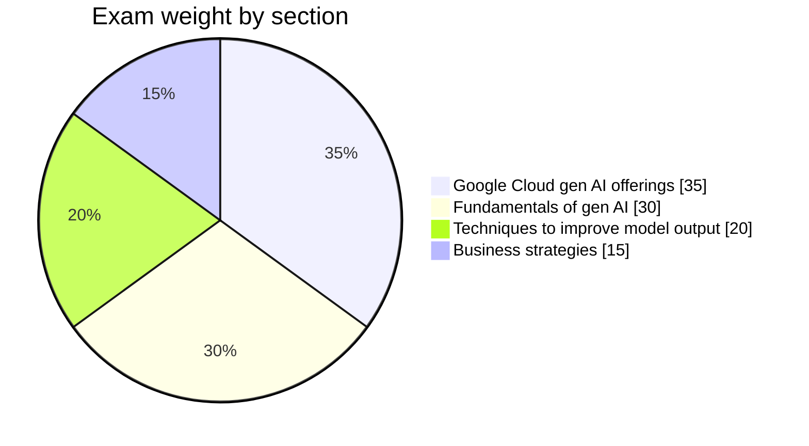
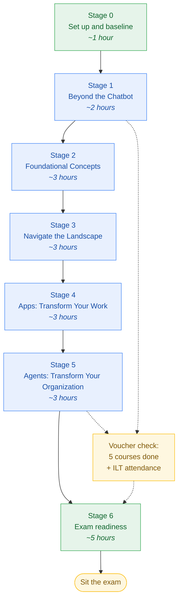

<div align="center">

# Google Cloud Generative AI Leader

### A complete, self-tracked study roadmap

[](https://cloud.google.com/learn/certification/generative-ai-leader)
[](https://cloud.google.com/learn/certification)
[](https://cloud.google.com/learn/certification/generative-ai-leader)
[](#study-effort)
[](LICENSE)

</div>

---

## What this is

A study roadmap for the Google Cloud **Generative AI Leader** exam, broken into seven stages that you work through in order. Every stage is a single Markdown file with a topic checklist, plain notes, extra reading and a short self test.

You tick the boxes as you go, so the repo itself becomes your progress tracker. Nothing to install, nothing to configure.

> This repo holds personal study notes and links to public Google material. It does not copy or redistribute any course slides, exam questions or program files.

---

## Exam at a glance

| | |
|---|---|
| **Exam name** | Google Cloud Certified Generative AI Leader |
| **Level** | Foundational (no prerequisites) |
| **Questions** | 50 to 60 multiple choice |
| **Time** | 90 minutes |
| **Languages** | English, Japanese, Spanish, Portuguese |
| **Delivery** | Online proctored, or at a Pearson VUE test centre |
| **Cost** | USD 99 (free if you have a program voucher) |
| **Valid for** | 3 years |
| **Negative marking** | None, so never leave a question blank |
| **Hands-on labs in exam** | None, it is all multiple choice |

**Pass mark is not published by Google.** Aim for 85% or better on practice tests before you book.

---

## What the exam actually tests



| Section | Weight | Covered in |
|---|---|---|
| 1. Fundamentals of gen AI | ~30% | [Stage 1](stages/stage-1-beyond-the-chatbot.md), [Stage 2](stages/stage-2-foundational-concepts.md), [Stage 3](stages/stage-3-navigate-the-landscape.md) |
| 2. Google Cloud's gen AI offerings | ~35% | [Stage 3](stages/stage-3-navigate-the-landscape.md), [Stage 4](stages/stage-4-apps-transform-your-work.md), [Stage 5](stages/stage-5-agents-transform-your-organization.md) |
| 3. Techniques to improve gen AI model output | ~20% | [Stage 2](stages/stage-2-foundational-concepts.md), [Stage 4](stages/stage-4-apps-transform-your-work.md) |
| 4. Business strategies for a successful gen AI solution | ~15% | [Stage 1](stages/stage-1-beyond-the-chatbot.md), [Stage 2](stages/stage-2-foundational-concepts.md), [Stage 5](stages/stage-5-agents-transform-your-organization.md) |

Section 2 is the heaviest. Give Stages 3, 4 and 5 the most attention.

Full breakdown: **[docs/exam-blueprint.md](docs/exam-blueprint.md)**

---

## The roadmap



### Stage list

| # | Stage | Course it follows | Effort | Status |
|---|---|---|---|---|
| 0 | [Set up and baseline](stages/stage-0-setup.md) | Pre-work | ~1 h | ☐ |
| 1 | [Gen AI: Beyond the Chatbot](stages/stage-1-beyond-the-chatbot.md) | Course 1 | ~2 h | ☐ |
| 2 | [Gen AI: Unlock Foundational Concepts](stages/stage-2-foundational-concepts.md) | Course 2 | ~3 h | ☐ |
| 3 | [Gen AI: Navigate the Landscape](stages/stage-3-navigate-the-landscape.md) | Course 3 | ~3 h | ☐ |
| 4 | [Gen AI Apps: Transform Your Work](stages/stage-4-apps-transform-your-work.md) | Course 4 | ~3 h | ☐ |
| 5 | [Gen AI Agents: Transform Your Organization](stages/stage-5-agents-transform-your-organization.md) | Course 5 | ~3 h | ☐ |
| 6 | [Exam readiness](stages/stage-6-exam-readiness.md) | Revision | ~5 h | ☐ |

<a id="study-effort"></a>
**Total: around 20 hours.** That matches Google's own recommendation of 15 to 20 hours of study.

---

## How to track your progress

1. Open the stage file you are working on.
2. Tick a checkbox the moment you can explain that topic to someone else, not when you have only read it.
3. Update your stage status and confidence score in **[PROGRESS.md](PROGRESS.md)**.
4. Commit. Your Git history becomes your study log.

```bash
git add .
git commit -m "stage 2: finish data types and learning approaches"
git push
```

A topic is done when you can answer the self test at the end of the stage without scrolling back up.

**Prefer tracking in GitHub Issues?** Two issue templates are set up for it:

| Template | Use it to |
|---|---|
| **Stage progress** | Open one issue per stage, work the checklist, close it when the stage is done |
| **Weak topic** | Log anything you got wrong, close it once you have answered it correctly twice |

Open a Project board over those issues if you want a visual view of where you are.

---

## Repo map

```
.
├── README.md                 you are here, start point and navigation
├── PROGRESS.md               your dashboard: stage status, confidence, mock scores
├── .github/                  issue templates for stage and weak-topic tracking
├── docs/
│   ├── exam-blueprint.md     the four exam sections, topic by topic
│   ├── study-method.md       how to study this so it sticks
│   ├── glossary.md           every term you need to recognise
│   ├── hands-on-practice.md  free tools and labs to try things yourself
│   └── resources.md          official links, kept in one place
└── stages/
    ├── stage-0-setup.md
    ├── stage-1-beyond-the-chatbot.md
    ├── stage-2-foundational-concepts.md
    ├── stage-3-navigate-the-landscape.md
    ├── stage-4-apps-transform-your-work.md
    ├── stage-5-agents-transform-your-organization.md
    └── stage-6-exam-readiness.md
```

---

## Quick links

| What | Where |
|---|---|
| Start here | [Stage 0: Set up and baseline](stages/stage-0-setup.md) |
| Your dashboard | [PROGRESS.md](PROGRESS.md) |
| What the exam covers | [docs/exam-blueprint.md](docs/exam-blueprint.md) |
| How to study this | [docs/study-method.md](docs/study-method.md) |
| Terms to recognise | [docs/glossary.md](docs/glossary.md) |
| Try things yourself | [docs/hands-on-practice.md](docs/hands-on-practice.md) |
| Every official link | [docs/resources.md](docs/resources.md) |

---

## Licence

[MIT](LICENSE) for the notes in this repo. Google Cloud, Gemini and related names belong to Google.
