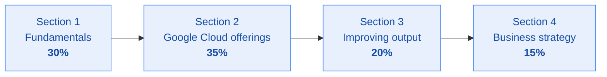

# Exam blueprint

[← Back to README](../README.md)

Everything the exam can ask you, listed section by section, with a pointer to the stage that covers it. Use this as your master checklist near the end, not at the start.

---

## How the four sections split

Roughly, out of 55 questions you can expect around 16 on fundamentals, 19 on Google Cloud offerings, 11 on improving output and 8 on business strategy.

---

## Section 1 · Fundamentals of gen AI (~30%)

### 1.1 Core gen AI concepts and use cases
Covered in [Stage 1](../stages/stage-1-beyond-the-chatbot.md) and [Stage 2](../stages/stage-2-foundational-concepts.md).

- Define the key terms: artificial intelligence, natural language processing, machine learning, generative AI, foundation model, multimodal model, diffusion model, large language model, prompt engineering, prompt tuning
- Explain supervised, unsupervised and reinforcement learning, and when each is used
- Name the stages of the machine learning lifecycle and the Google Cloud tool that supports each one
- Pick a foundation model using the real selection factors: modality, context window, security, availability and reliability, cost, performance, fine-tuning and customization, ease of integration
- Map a business need to one of the four gen AI problem classes: create, summarise, discover, automate

### 1.2 Data types used in gen AI
Covered in [Stage 2](../stages/stage-2-foundational-concepts.md).

- Data quality: accuracy, completeness, representativeness, consistency, relevance
- Data accessibility: availability, cost, format
- Structured versus unstructured data, with examples
- Labeled versus unlabeled data, and which learning approach each enables
- Why each of these matters to a business, not just to an engineer

### 1.3 The layers of the gen AI landscape
Covered in [Stage 3](../stages/stage-3-navigate-the-landscape.md).

- Infrastructure, models, platform, agents, applications
- What sits in each layer and what decision each layer forces a business to make

### 1.4 Google's foundation models
Covered in [Stage 2](../stages/stage-2-foundational-concepts.md).

- Gemini: multimodal reasoning, conversation, content creation, question answering
- Gemma: lightweight open models for local and specialised deployment
- Imagen: images from text
- Veo: video from text or images
- Which one fits which use case

---

## Section 2 · Google Cloud's gen AI offerings (~35%)

This is the biggest section. Most of it is "which product solves this problem", so learn products by the job they do.

### 2.1 Why Google Cloud
Covered in [Stage 5](../stages/stage-5-agents-transform-your-organization.md).

- AI-first approach to innovation
- Enterprise ready: responsible, secure, private, reliable, scalable
- The wider Google ecosystem
- Open approach, including open models
- AI-optimised infrastructure
- Customer control over their own data
- Development made accessible through low-code and no-code tools, pre-trained models and APIs

### 2.2 Prebuilt offerings for AI-powered work
Covered in [Stage 4](../stages/stage-4-apps-transform-your-work.md).

- Gemini app and Gemini Advanced
- Gemini Enterprise
- Gemini for Google Workspace
- Gemini for Google Cloud
- Gemini Notebook and NotebookLM

### 2.3 Customer experience offerings
Covered in [Stage 5](../stages/stage-5-agents-transform-your-organization.md).

- External search: Agent Search (also known as Vertex AI Search) and Google Search
- Customer Engagement Suite: conversational agents, Agent Assist, conversational insights, contact centre as a service

### 2.4 Developer empowerment
Covered in [Stage 3](../stages/stage-3-navigate-the-landscape.md) and [Stage 5](../stages/stage-5-agents-transform-your-organization.md).

- Agent Platform (the platform previously named Vertex AI): Model Garden, Agent Search, AutoML
- Retrieval augmented generation offerings
- Building custom agents

### 2.5 Agent tooling
Covered in [Stage 5](../stages/stage-5-agents-transform-your-organization.md).

- How agents use tools: extensions, functions, data stores, plugins
- Google Cloud services and pre-built AI APIs an agent can call
- When to use Agent Studio and when to use Google AI Studio

---

## Section 3 · Techniques to improve model output (~20%)

### 3.1 Overcoming model limitations
Covered in [Stage 2](../stages/stage-2-foundational-concepts.md).

- The six limitations: data dependency, knowledge cut-off, bias, fairness, hallucinations, edge cases
- The fixes: grounding, retrieval augmented generation, prompt engineering, fine-tuning, human in the loop
- Continuous monitoring: upgrades, key performance indicators, security patches, versioning, performance tracking, drift monitoring, Feature Store

### 3.2 Prompt engineering
Covered in [Stage 4](../stages/stage-4-apps-transform-your-work.md).

- What prompt engineering is and why output quality depends on it
- Zero-shot, one-shot, few-shot, role prompting, prompt chaining
- Chain of thought, ReAct, metaprompting
- Reusable prompts and Gems

### 3.3 Grounding techniques
Covered in [Stage 4](../stages/stage-4-apps-transform-your-work.md).

- First-party data, third-party data and world data as grounding sources
- How retrieval augmented generation changes the output
- Google's grounding offerings: Agent Search, RAG APIs, grounding with Google Search
- Sampling settings: token count, temperature, top-p, safety settings, output length

---

## Section 4 · Business strategies for a successful gen AI solution (~15%)

### 4.1 Implementing a transformational solution
Covered in [Stage 1](../stages/stage-1-beyond-the-chatbot.md) and [Stage 5](../stages/stage-5-agents-transform-your-organization.md).

- Types of gen AI solution and the factors that shape which one you need
- Choosing the right solution for a scenario
- Steps to integrate it into how the business already works
- How to measure impact

### 4.2 Secure AI
Covered in [Stage 2](../stages/stage-2-foundational-concepts.md).

- Security at every stage of the machine learning lifecycle
- Google's Secure AI Framework (SAIF)
- Google Cloud security tools: secure-by-design infrastructure, Identity and Access Management, Security Command Center, workload monitoring

### 4.3 Responsible AI
Covered in [Stage 2](../stages/stage-2-foundational-concepts.md).

- Transparency
- Privacy: the risks, anonymisation and pseudonymisation
- Data quality, bias and fairness
- Accountability and explainability

---

## A note on product names

Google has been renaming parts of its AI stack. You may see both the old and the new name in study material, and either could appear in a question.

| Older name | Newer name you may also see |
|---|---|
| Vertex AI | Agent Platform, or Gemini Enterprise Agent Platform |
| Vertex AI Search | Agent Search |
| Vertex AI Agent Builder | Agent Studio |
| Agentspace | Gemini Enterprise |
| Imagen (in some decks) | Nano Banana |

Learn what the product **does**. The name on the slide may differ from the name in the question.

---

[← Back to README](../README.md) · [Next: Study method →](study-method.md)
