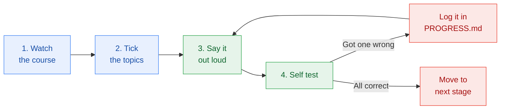

# How to study this so it sticks

[← Back to README](../README.md)

This exam is not hard, but it is wide. The failure mode is not difficulty, it is forgetting the first half by the time you reach the end. This page is the method that stops that.

---

## The loop for every stage

**Step 3 is the one people skip.** Reading feels like learning but it is not. Close the file and explain the topic out loud in your own words. If you stall, you have not learned it yet.

---

## Five rules that actually matter

### 1. Learn products by the job, not the name
Section 2 is 35% of the exam and it is mostly "which product fits this situation". Do not memorise feature lists. For every product, answer one question: **what job does this do that the others do not?**

> Gemini for Workspace: puts AI inside the docs and email people already use.
> Agent Search: lets a company search its own content.
> Model Garden: a catalogue to pick a model from.

### 2. Watch for the "best answer" trap
Most questions give you two or three answers that are technically fine. Only one is the **best** for the scenario described. Read the scenario twice and underline the constraint: no coding skills, short on time, needs real-time response, handles sensitive data. The constraint picks the answer.

### 3. Spot the distractor pattern
Wrong answers in this exam repeat the same shapes:
- The one that is a different layer of the stack (infrastructure when they asked about agents)
- The one that solves a real problem but not this problem
- The absolute word: always, never, guarantees, completely eliminates
- The over-engineered option: build a custom model from scratch, when a pre-trained API would do

### 4. Do not study in one sitting
Short sessions beat one long one. Two hours twice beats four hours once. Between sessions, your brain does the work for free.

### 5. Revisit old stages while learning new ones
Before starting a new stage, spend five minutes on the self test of the stage before it. That five minutes is worth more than an extra hour of new reading.

---

## Using NotebookLM to revise

Google's own study guide suggests this, and it works well.

1. Open [NotebookLM](https://notebooklm.google.com).
2. Create a notebook and add your sources: the official exam guide, the official study guide, your course notes.
3. Ask it questions that force recall rather than summary:
   - "Give me ten scenario questions about choosing between grounding and fine-tuning."
   - "Quiz me on the five layers of the gen AI landscape, one at a time."
   - "Explain the difference between a conversational agent and a workflow agent as if I know nothing."
4. Generate the audio overview and listen to it while commuting or walking.

Free accounts have a daily limit on chat queries and audio generations, so save it for revision rather than first learning.

---

## Flashcard list

If you use flashcards, these are the ones worth making. Term on the front, one sentence on the back.

**Must know cold**
AI · machine learning · deep learning · generative AI · foundation model · large language model · diffusion model · multimodal · supervised learning · unsupervised learning · reinforcement learning · structured data · unstructured data · labeled data · unlabeled data · hallucination · knowledge cut-off · bias · fairness · edge case · grounding · retrieval augmented generation · fine-tuning · prompt engineering · zero-shot · one-shot · few-shot · chain of thought · ReAct · temperature · top-p · token · context window · human in the loop · agent · reasoning loop · conversational agent · workflow agent · edge computing

**Google products**
Gemini · Gemini Advanced · Gemini for Workspace · Gemini for Google Cloud · Gemini Enterprise · Gemini Nano · Gemma · Imagen · Veo · Chirp · NotebookLM · Agent Platform · Model Garden · AutoML · Agent Search · Agent Studio · Google AI Studio · Feature Store · Model Registry · Model Evaluation · Model Monitoring · Pipelines · BigQuery · Cloud Storage · Pub/Sub · Cloud SQL · Spanner · Identity and Access Management · Security Command Center · SAIF · LiteRT · TPU · GPU

Full definitions: [glossary.md](glossary.md)

---

## When you are ready to book

All of these must be true:

- [ ] Every stage marked done in [PROGRESS.md](../PROGRESS.md)
- [ ] Every exam section at confidence 4 or 5
- [ ] Two practice attempts in a row at 85% or above
- [ ] Weak areas list cleared
- [ ] You can explain all five landscape layers without notes
- [ ] You can explain when to ground, when to fine-tune and when to just prompt better

---

[← Exam blueprint](exam-blueprint.md) · [Next: Glossary →](glossary.md)
