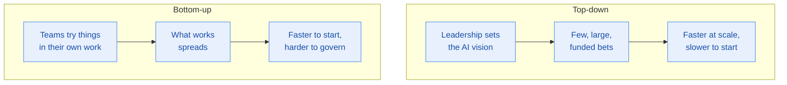

# Stage 1 · Gen AI: Beyond the Chatbot

[← Stage 0](stage-0-setup.md) · [README](../README.md) · [Progress](../PROGRESS.md) · [Next: Stage 2 →](stage-2-foundational-concepts.md)

**Course:** Gen AI: Beyond the Chatbot (first course in the learning path)
**Course link:** https://www.skills.google/paths/1951/course_templates/1268
**Effort:** around 2 hours
**Maps to exam sections:** 1.1 (core concepts and use cases), 4.1 (implementing a solution)

---

## What this stage gives you

The business view. This course is less about how models work and more about why a company would use one, and what goes wrong when they use one badly. The exam calls itself a **Leader** exam for a reason: a good chunk of the questions are about judgement, not technology.

---

## Topic checklist

Tick each one only when you can explain it out loud.

### Gen AI for business
- [ ] What generative AI is, in one sentence, without using the word "AI"
- [ ] How generative AI differs from traditional AI (traditional AI analyses and predicts, generative AI creates)
- [ ] The four problem classes gen AI solves: **create**, **summarise**, **discover**, **automate**
- [ ] At least two real use cases for each of those four classes
- [ ] Why a chatbot is only one small slice of what gen AI can do

### Foundations at a high level
- [ ] What a foundation model is and why it can do many tasks
- [ ] What a prompt is, and why the same model gives different quality answers to different prompts
- [ ] Why output quality depends on the data behind the model

### Gen AI strategy
- [ ] The parts of a gen AI strategy: vision, use case prioritisation, capability investment, change management, measuring value, responsible AI
- [ ] **Top-down** strategy: leadership sets the direction and funds a few big bets
- [ ] **Bottom-up** strategy: teams experiment, the useful ideas get adopted
- [ ] When each approach fits
- [ ] Why change management matters as much as the technology
- [ ] How to measure whether a gen AI project actually delivered value

---

## Notes that matter for the exam

### The four problem classes

This framing comes up again and again. Learn it as a table, because scenario questions are easiest to answer by matching the scenario to a class first.

| Class | What it does | Typical use case |
|---|---|---|
| **Create** | Turns an idea into content | Product descriptions from images, images from text, draft marketing copy |
| **Summarise** | Condenses something long into something short | Meeting notes, video summaries, condensing a knowledge base |
| **Discover** | Helps someone find what they need | Searching internal documents, surfacing an insight, monitoring events |
| **Automate** | Runs a process with little human input | Extracting contract details, classifying feedback and raising a ticket |

### Traditional AI versus generative AI

| | Traditional AI | Generative AI |
|---|---|---|
| Trained on | Specific data for one purpose | Massive, diverse data |
| Good at | Classification, prediction, detection | Creating new content |
| Output | A label, a score, a forecast | Text, image, audio, video, code |
| Reusable for new tasks | Rarely, needs retraining | Often, with a different prompt |

### Top-down and bottom-up

Most organisations need both. Exam questions usually describe a situation (a regulated bank, a small marketing team) and ask which approach fits.

### Measuring value

If a question asks how to tell whether a gen AI project succeeded, the good answers talk about **business outcomes tied to the original goal**: time saved, cost per case, customer satisfaction, error rate. The weak answers talk about model accuracy alone, or about how advanced the technology is.

---

## Extra resources

| Resource | Why bother |
|---|---|
| [A generative AI primer for busy executives](https://cloud.google.com/transform) | Short, business-level framing, exactly the tone of this exam |
| [Real-world gen AI use cases](https://cloud.google.com/transform/101-real-world-generative-ai-use-cases-from-industry-leaders) | Google's list of real customer use cases, good for scenario questions |
| [Google Cloud AI Principles](https://ai.google/responsibility/principles/) | Referenced by the official study guide |

---

## Self test

<b>1.</b> A retailer wants to turn thousands of raw customer reviews into a weekly one-page digest for the product team. Which gen AI problem class is this?

**Summarise.** The content already exists, the job is to condense it. If they wanted to find specific reviews it would be discover, and if they wanted to write new reviews it would be create.

<b>2.</b> What is the main difference between traditional AI and generative AI?

Traditional AI is trained for a specific purpose on specific data and produces predictions or classifications. Generative AI is trained on massive, diverse data and produces new content, and the same model can be pointed at many different tasks.

<b>3.</b> A hospital group's leadership picks three AI projects for the year, funds them centrally and sets the success measures. Which strategy approach is this?

**Top-down.** Direction and funding come from leadership rather than from teams experimenting.

<b>4.</b> Which is the stronger way to measure the value of a gen AI customer support project?

Change in business outcomes such as average handling time, resolution rate or customer satisfaction, compared against the baseline before the project. Model accuracy on its own does not tell you whether the business gained anything.

<b>5.</b> Why is change management part of a gen AI strategy?

Because the tool only creates value if people actually use it in their work. Training, trust, clear policies and adjusting existing processes decide whether adoption happens. A technically good solution that nobody uses returns nothing.

<b>6.</b> A logistics company wants to pull delivery dates, penalty clauses and renewal terms out of 40,000 PDF contracts. Which problem class, and why not the others?

**Automate.** The work is a repetitive process over many documents with a structured result. It is not create (nothing new is written), not summarise (they want specific fields, not a shorter version) and not discover (they are not searching for one thing, they are processing all of them).

**Score out of 6 → [PROGRESS.md](../PROGRESS.md)**

---

[← Stage 0](stage-0-setup.md) · [Next: Stage 2 · Foundational Concepts →](stage-2-foundational-concepts.md)
