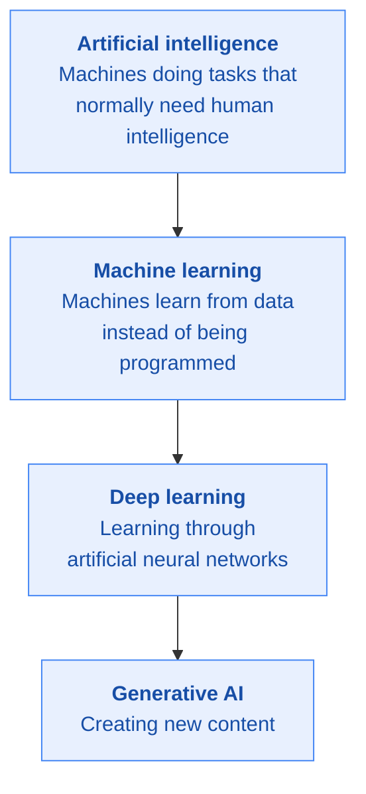
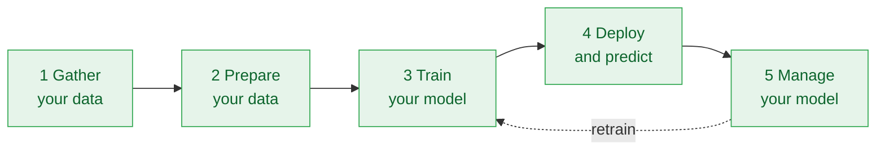
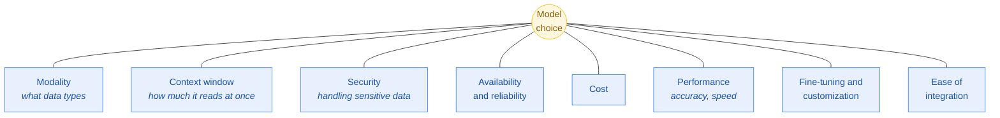

# Stage 2 · Gen AI: Unlock Foundational Concepts

[← Stage 1](stage-1-beyond-the-chatbot.md) · [README](../README.md) · [Progress](../PROGRESS.md) · [Next: Stage 3 →](stage-3-navigate-the-landscape.md)

**Course:** Gen AI: Unlock Foundational Concepts (second course in the learning path)
**Course link:** https://www.skills.google/paths/1951
**Effort:** around 3 hours
**Maps to exam sections:** 1.1, 1.2, 1.4, 3.1, 4.2, 4.3

---

## What this stage gives you

The vocabulary. Almost every later topic assumes you already know what a foundation model is, what makes data good, and what goes wrong with models. This is the stage to go slowly on. If something here is fuzzy, Stage 4 and Stage 5 will feel much harder than they are.

Three lessons: core concepts, foundation models, then building AI securely and responsibly.

---

## Topic checklist

### Lesson 1 · Core gen AI concepts
- [ ] AI, machine learning and generative AI, and how they nest inside each other
- [ ] Deep learning, and where it sits in that nesting
- [ ] Why different data creates different models
- [ ] Data quality: **accuracy**
- [ ] Data quality: **completeness**
- [ ] Data quality: **representativeness**
- [ ] Data quality: **consistency**
- [ ] Data quality: **relevance**
- [ ] Data accessibility: availability, cost, format
- [ ] Structured versus unstructured data, with examples of each
- [ ] Labeled versus unlabeled data
- [ ] Supervised learning: what it needs and a real example
- [ ] Unsupervised learning: what it needs and a real example
- [ ] Reinforcement learning: what it needs and a real example
- [ ] The five stages of the ML lifecycle
- [ ] Which Google Cloud tool supports each lifecycle stage
- [ ] What Identity and Access Management does and why it belongs in an AI conversation

### Lesson 2 · Foundation models
- [ ] What a foundation model is and why it generalises
- [ ] Large language models
- [ ] Diffusion models
- [ ] Multimodal models
- [ ] The eight factors for choosing a model
- [ ] Google's models: Gemini, Gemma, Imagen, Veo (and where Chirp and embedding models fit)
- [ ] The six foundation model limitations
- [ ] The four techniques that work around those limitations
- [ ] Human in the loop, and when you need it

### Lesson 3 · Secure and responsible AI
- [ ] Security risks at each stage of the ML lifecycle
- [ ] What the Secure AI Framework (SAIF) is for
- [ ] Google Cloud's security tooling for AI
- [ ] The four foundations of responsible AI
- [ ] The legal areas that matter for AI

---

## Notes that matter for the exam

### AI, ML, deep learning, gen AI

Exam questions love to ask "which term describes X". Keep these four separate in your head:

| Term | One-line definition |
|---|---|
| Artificial intelligence | The broad field of making machines do things that need human intelligence |
| Machine learning | A subset of AI where machines learn patterns from data rather than following written rules |
| Deep learning | A technique inside machine learning that uses artificial neural networks with many layers |
| Generative AI | An application of deep learning that creates new content |

Neural networks can use both labeled and unlabeled data, which is called **semi-supervised learning**.

### Data quality, five dimensions

| Dimension | What breaks without it |
|---|---|
| **Accuracy** | The model learns wrong patterns and makes wrong predictions |
| **Completeness** | Not enough data, or not enough coverage, so predictions are unreliable |
| **Representativeness** | Skewed samples lead to biased outcomes for the groups left out |
| **Consistency** | Mixed formats and labels confuse the model and slow learning |
| **Relevance** | The data does not describe the problem the AI is meant to solve |

> Some Google material lists more dimensions (freshness, volume, validity, uniqueness). If you see those, they are the same idea at finer grain. The five above are the ones the course emphasises.

### Data accessibility, three questions

- **Availability:** does the data exist and can you get to it? If not, nothing else matters.
- **Cost:** good data is expensive, and that cost can kill a project.
- **Format:** the model has to be able to read it.

### Data types

| | Structured | Unstructured |
|---|---|---|
| Shape | Rows and columns | No predefined shape |
| Examples | Customer ID, order date, price, a 1 to 5 star rating | Free-text feedback, emails, photos, audio, video |
| Stored in | Relational databases, spreadsheets | Object storage, document stores |
| Search | Easy | Needs more sophisticated techniques |

| | Labeled | Unlabeled |
|---|---|---|
| What it is | Tagged with a name, type or number that gives it meaning | Raw, untagged |
| Example | 10,000 photos each marked "cat" or "dog" | 10,000 unsorted photos |
| Enables | Supervised learning | Unsupervised learning |

### The three learning approaches

| Approach | Data it needs | How it learns | Example |
|---|---|---|---|
| **Supervised** | Labeled | Learns the mapping from input to known correct output | Spam detection, fraud detection, house price prediction |
| **Unsupervised** | Unlabeled | Finds natural groupings and patterns on its own | Customer segmentation, anomaly detection, topic discovery |
| **Reinforcement** | No dataset, an environment | Trial and error with rewards and penalties | Game-playing AI, robotics, real-time resource allocation |

**Exam shortcut:** if the scenario mentions labels or known correct answers, it is supervised. If it says "no labels yet" or "find groupings", it is unsupervised. If it mentions rewards, penalties or trial and error, it is reinforcement.

### The ML lifecycle and the Google Cloud tool for each stage

| Stage | What happens | Google Cloud tools |
|---|---|---|
| Gather | Decide what data you need and collect it | Pub/Sub (real-time streaming), Cloud Storage (unstructured), Cloud SQL and Spanner (structured) |
| Prepare | Clean, transform, format and label | BigQuery (analysis), BigQuery universal catalog (governance) |
| Train | Build the model from the data | Agent Platform (the managed training environment, previously named Vertex AI) |
| Deploy and predict | Make the trained model available for use | Agent Platform endpoints |
| Manage | Keep it working over time | Versioning, performance tracking, drift monitoring, Feature Store, Model Garden, Pipelines |

**Identity and Access Management (IAM)** runs across all of this: create and manage user accounts, assign roles, grant and revoke permissions, audit activity, monitor your security position.

### Foundation models

A foundation model is a large model, trained with deep learning on a massive and diverse dataset, that picks up a broad understanding of the world and can then be pointed at many different tasks.

| Type | What it is best at |
|---|---|
| **Large language model** | Understanding and generating human language: translation, writing, answering questions |
| **Diffusion model** | Generating high-quality images, audio and video by repeatedly refining noise into structure |
| **Multimodal model** | Taking in and producing more than one data type: text, image, audio, video, code |

### Choosing a model, the eight factors

### Google's models

| Model | What it does | Pick it when |
|---|---|---|
| **Gemini** | Multimodal reasoning, conversation, content creation, question answering | You need one capable model across text, image, audio, video and code |
| **Gemma** | Lightweight open models | You need local deployment, full control, or a smaller specialised model |
| **Imagen** (shown as Nano Banana in newer material) | High-quality images from text | Image generation and editing |
| **Veo** | Video from text or images | Video generation |
| **Chirp** | Speech | Speech recognition and audio tasks |
| **Embedding models** | Turn text or images into numbers that capture meaning | Semantic search, similarity, retrieval behind RAG |
| **Gemini Nano** | A small Gemini built for devices | On-device and offline use, see Stage 3 |

### The six limitations, and the four fixes

| Limitation | What it means |
|---|---|
| **Data dependency** | Performance is only as good as the training data. Gaps and biases flow into the output. |
| **Knowledge cut-off** | The model only knows up to the last date it was trained on. |
| **Bias** | Biases in the training data can be reproduced and even amplified. |
| **Fairness** | Fairness means different things to different people, and fairness tests only check the categories they were designed for. |
| **Hallucinations** | The model produces answers that sound right but are not true. |
| **Edge cases** | Rare, unusual scenarios expose weaknesses and produce strange results. |

| Fix | What it does | Best for |
|---|---|---|
| **Prompt engineering** | Writing a better instruction to steer the output | Quick wins, no change to the model |
| **Grounding** | Connecting the model to specific, reliable data | Hallucinations, company-specific answers |
| **Retrieval augmented generation (RAG)** | A grounding method: search a knowledge base, add what you find to the prompt, then generate | Knowledge cut-off, hallucinations, answers from your own documents |
| **Fine-tuning** | Further training on your own task-specific dataset | Specialised domains and specific output formats, when prompting is not enough |

**Human in the loop (HITL)** adds people where judgement is needed: content moderation, sensitive applications, high-risk decisions. The review can happen **before** generation or **after** generation.

> The classic exam question: "prompt engineering did not get the result, the model needs to specialise in a narrow domain with a specific output format." That is **fine-tuning**. If the problem is out-of-date or made-up facts, that is **grounding or RAG**.

### Secure AI

Security is not one step, it applies at every lifecycle stage.

| Stage | What to secure |
|---|---|
| Gather | Protect the data, control who can access, add to or input data |
| Prepare | Anonymise sensitive data, validate it, process it securely, log and monitor |
| Train | Protect training data and model parameters from unauthorised access or change |
| Deploy | Control access to the model, verify sources and check pre-built models for vulnerabilities |
| Manage | Stay current on best practice, update regularly, watch for anomalies and tampering, review permissions |

Across all of it: guard against adversarial attacks and monitor outputs so the model does not leak data or produce harmful content.

**Secure AI Framework (SAIF)** is Google's framework of security standards for building and deploying AI systems responsibly.

**Google Cloud security tools:** secure-by-design infrastructure, encryption, Identity and Access Management, Security Command Center, and workload monitoring. Google Threat Intelligence and Mandiant add frontline threat expertise.

### Responsible AI, the four foundations

| Foundation | What it asks of you |
|---|---|
| **Transparency** | People should understand how the system works and how their information is used |
| **Privacy** | Anonymise or pseudonymise data, and stop the model leaking sensitive training data |
| **Data quality, bias and fairness** | Good data and fair outcomes, because AI inherits society's biases |
| **Accountability and explainability** | Someone owns the outcome, and the decision process can be explained |

**Legal areas to know:** data privacy, non-discrimination, intellectual property, product liability. The legal landscape is still changing, so ongoing legal review is part of responsible AI, not a one-time check.

---

## Extra resources

| Resource | Why bother |
|---|---|
| [Google's Secure AI Framework](https://safety.google/cybersecurity-advancements/saif/) | The official SAIF page, directly named in the exam guide |
| [Google AI Principles](https://ai.google/responsibility/principles/) | The responsible AI foundations in Google's own words |
| [What is retrieval augmented generation?](https://cloud.google.com/use-cases/retrieval-augmented-generation) | Clearest short explanation of RAG |
| [Introduction to Generative AI learning path](https://www.cloudskillsboost.google/paths/118) | Free beginner courses that re-teach this stage from a different angle |

---

## Self test

<b>1.</b> Put these in order from broadest to narrowest: deep learning, generative AI, machine learning, artificial intelligence.

Artificial intelligence → machine learning → deep learning → generative AI.

<b>2.</b> A bank trains a loan model on historic data, but the dataset covers one city and mostly one age group. Which data quality dimension is the problem?

**Representativeness.** The sample does not reflect the population the model will be used on, which leads to biased and unfair outcomes. Accuracy is about the values being correct, which is a different issue.

<b>3.</b> A factory has years of sensor readings with no labels. They want to find unusual machine behaviour. Which learning approach?

**Unsupervised learning.** No labels, and the goal is to discover patterns and groupings, which is exactly what unsupervised learning does.

<b>4.</b> An assistant confidently gives a wrong answer about a product your company launched last month. What is happening, and what are the two best fixes?

Two limitations are combining: **knowledge cut-off** (the launch happened after training) and **hallucination** (it invented a plausible answer rather than saying it did not know). The best fixes are **grounding** the model in your product documentation, usually through **retrieval augmented generation**.

<b>5.</b> When is fine-tuning the right answer rather than prompt engineering?

When prompting alone is not getting the result, and the model needs to specialise for a specific task, domain or output format. Fine-tuning further trains the model on a new, task-specific dataset. Prompt engineering changes the instruction only, not the model.

<b>6.</b> What is the Secure AI Framework for?

It sets security standards for building and deploying AI systems responsibly, aimed at the specific threats and challenges AI brings. It is not about slowing AI down and not only about external attacks.

<b>7.</b> Which Google Cloud service would you use to gather real-time streaming data for an AI project?

**Pub/Sub.** Cloud Storage is for unstructured data at rest, Cloud SQL and Spanner are for structured data, and BigQuery is for analysis at the prepare stage.

<b>8.</b> A hospital wants an AI system to suggest diagnoses, with a doctor always confirming before anything reaches a patient. What is this pattern, and which review type is it?

**Human in the loop**, with **post-generation review**. The model produces output and a qualified person checks it before it is acted on. This is the expected pattern for high-risk decisions.

**Score out of 8 → [PROGRESS.md](../PROGRESS.md)**

---

[← Stage 1](stage-1-beyond-the-chatbot.md) · [Next: Stage 3 · Navigate the Landscape →](stage-3-navigate-the-landscape.md)
