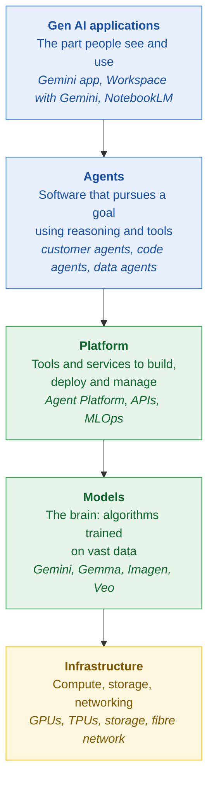
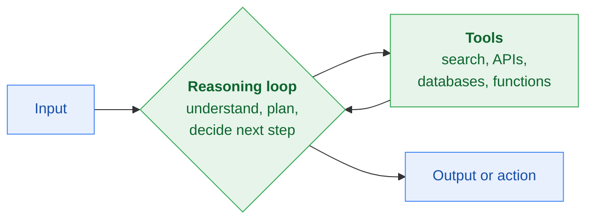
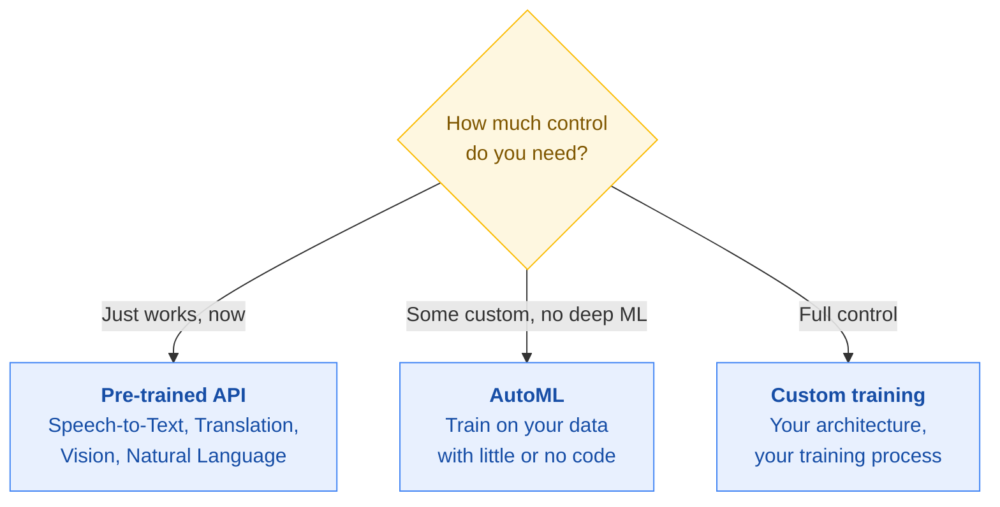

# Stage 3 · Gen AI: Navigate the Landscape

[← Stage 2](stage-2-foundational-concepts.md) · [README](../README.md) · [Progress](../PROGRESS.md) · [Next: Stage 4 →](stage-4-apps-transform-your-work.md)

**Course:** Gen AI: Navigate the Landscape (third course in the learning path)
**Course link:** https://www.skills.google/paths/1951
**Effort:** around 3 hours
**Maps to exam sections:** 1.3 (landscape layers), 2.1, 2.4, 4.1

---

## What this stage gives you

The map. Once you can place any product or question into one of five layers, a large part of the exam becomes straightforward. Many questions are really asking "which layer is this?" wearing a disguise.

Four lessons: the landscape, applications and agents, platform and models and infrastructure, then project resources and management.

---

## Topic checklist

### Lesson 1 · The gen AI landscape
- [ ] The five layers, in order, top to bottom
- [ ] Applications layer: what it is and examples
- [ ] Agents layer: what it is and examples
- [ ] Platform layer: what it is and examples
- [ ] Models layer: what it is and examples
- [ ] Infrastructure layer: what it is and examples
- [ ] Given a statement, name the layer it belongs to

### Lesson 2 · Applications and agents
- [ ] What an agent is, in one sentence
- [ ] How an agent relates to an application
- [ ] The three capabilities agents add: natural language understanding, automating complex tasks, personalisation
- [ ] Multi-agent systems and why you would split work across agents
- [ ] Conversational agents: how they work and what they are for
- [ ] Workflow agents: how they work and what they are for
- [ ] The six agent use case types: customer service, employee productivity, creative, code, data, security
- [ ] What makes an agent more than a model: the reasoning loop plus tools
- [ ] Reasoning frameworks: ReAct and chain of thought

### Lesson 3 · Platform, models and infrastructure
- [ ] What the platform layer provides
- [ ] Agent Platform (previously Vertex AI) and what it streamlines
- [ ] MLOps tools: Feature Store, Model Registry, Model Evaluation
- [ ] MLOps tools: workflow orchestration (Pipelines) and Model Monitoring
- [ ] Model Garden and what is in it
- [ ] AutoML and the data types and objectives it supports
- [ ] The three build options: pre-built API, AutoML, fully custom
- [ ] Infrastructure: GPUs and TPUs
- [ ] Infrastructure: hypercomputers
- [ ] Infrastructure: high-performance storage
- [ ] Infrastructure: networking
- [ ] Edge computing and its three benefits
- [ ] LiteRT and Gemini Nano
- [ ] Edge versus cloud: how to choose

### Lesson 4 · Project resources and management
- [ ] The three roles: business leaders, developers, AI practitioners
- [ ] The three things you pay for
- [ ] The four pricing models
- [ ] The four pricing metrics
- [ ] The four factors that push cost up
- [ ] Solution needs: scale, customization, user interaction, privacy
- [ ] Other considerations: latency, connectivity, accuracy, explainability
- [ ] Maintenance: what has to keep happening after launch

---

## Notes that matter for the exam

### The five layers

**How to answer layer questions fast:**

| The scenario mentions | The layer is |
|---|---|
| A user typing into a website or app | Applications |
| Deciding what tasks to perform, calling tools, acting autonomously | Agents |
| Labelling data, running experiments, deploying, monitoring | Platform |
| Generating the actual text, image or prediction | Models |
| More processing power, specialised chips, storage, connectivity | Infrastructure |

The classic trap: "which layer generates grammatically correct text" is the **model** layer, while "which layer decides which style guide to apply" is the **agent** layer.

### Agents

An agent is software that tries to achieve a goal by observing its environment and acting on it with the tools it has.

What separates an agent from a plain model is two things:

If an exam question asks what distinguishes agents from standalone models, the answer is **a reasoning loop and the ability to use tools**.

**Agent and application together:** the application gives the interface and the overall purpose, the agent does the intelligent work inside it. They are not the same thing and they are not independent.

### Two kinds of agent

| | Conversational agent | Workflow agent |
|---|---|---|
| Started by | A person typing or speaking | A defined task or a trigger |
| Interaction | Back and forth dialogue | Runs the process through |
| Ends with | A response | A result or completed action |
| Examples | Answering questions, casual chat, looking up information | Ecommerce order fulfilment, customer onboarding, automated research, security log parsing |

Both follow the same five steps: input, the agent understands, the agent calls a tool, the agent generates, the agent delivers.

### Agent use cases

| Type | What it does |
|---|---|
| Customer service | Answers questions, resolves issues, gives personalised recommendations |
| Employee productivity | Helps staff find information, manage tasks, automate workflows |
| Creative | Generates ideas, creates content, translates |
| Code | Writes, reviews, debugs and generates code |
| Data | Analyses large datasets, spots trends, extracts insights |
| Security | Automates security tasks such as log parsing and anomaly detection |

### Reasoning frameworks

| Framework | What it does |
|---|---|
| **Chain of thought** | The model works through its reasoning step by step before answering, which improves accuracy on multi-step problems |
| **ReAct** (reasoning and acting) | The model alternates between thinking about what to do and taking an action with a tool, then uses the result to think again |

### The platform layer

**Agent Platform** (previously Vertex AI, also appears as Gemini Enterprise Agent Platform) brings the whole ML workflow into one place: infrastructure, pre-trained models, and tools to build, deploy and manage.

Key features: open and flexible, powerful infrastructure, pre-trained models, comprehensive tooling, customization, easy integration.

**MLOps tools and what each is for:**

| Tool | Use it when you need to |
|---|---|
| **Feature Store** | Share, serve and reuse ML features consistently |
| **Model Registry** | Track versions, record changes, organise models through their lifecycle |
| **Model Evaluation** | Compare model performance against each other |
| **Pipelines / workflow orchestration** | Automate the whole pipeline from data prep to deployment |
| **Model Monitoring** | Watch for performance decline, input skew and drift, and trigger retraining |

> Memorise this table as "problem → tool". Exam questions give you the problem in plain words: "your deployed model's performance is declining" is **Model Monitoring**, "you need to track versions and changes" is **Model Registry**.

### The models layer: three ways to get a model

**Model Garden** is the catalogue: over 160 models you can discover, customise and deploy.

| In Model Garden | Examples |
|---|---|
| Google foundation models | Gemini, Imagen, Veo, Chirp |
| Google pre-trained APIs | Speech-to-Text, Natural Language, Translation, Vision |
| Open models | Gemma, CodeGemma, PaliGemma, Llama, Mistral |
| Third-party models | Anthropic's Claude family |

**AutoML supports:**

| Data type | Objectives |
|---|---|
| Image | Classification, object detection |
| Video | Action recognition, classification, object tracking |
| Tabular | Classification or regression, forecasting |

### The infrastructure layer

| Component | What it does |
|---|---|
| **GPUs and TPUs** | Specialised processors built for parallel processing. GPUs are general-purpose parallel compute, TPUs are custom-designed for AI workloads. |
| **Hypercomputers** | Many machines connected to act as one, giving the scale needed to train very large models |
| **High-performance storage** | Large-scale, reliable storage with fast read and write, so training is not waiting on data |
| **Networking** | Google's global fibre network, high bandwidth and low latency, so all those processors can coordinate |

### Edge computing

Edge means running AI on a device or a server close to where the data is, instead of in the cloud.

**Three benefits:** real-time responsiveness, better data privacy (the data stays on the device), and it works without a reliable internet connection.

- **LiteRT** (Lite Runtime) makes ML models run efficiently on edge and mobile devices.
- **Gemini Nano** is a Gemini model built for devices. It powers on-device features on Pixel phones and is available to Android developers through the AI Edge SDK.

**Edge or cloud?**

| Choose edge when | Choose cloud when |
|---|---|
| Latency must be near zero (a medical device during surgery) | You need to handle huge volumes (millions of support queries) |
| Data must not leave the device | You need to analyse data from many sources centrally |
| Connectivity is unreliable | The model is too large for a device |

### People, cost and time

**Three roles:**

| Role | What they do | Typical tools |
|---|---|---|
| **Business leaders** | Use pre-built gen AI to improve daily work and customer experience | Google Workspace with Gemini |
| **Developers** | Build and deploy custom agents, integrate AI into existing applications | AI Applications, code generation, pre-trained APIs, Agent Platform |
| **AI practitioners** | Customise, deploy and optimise models, and apply responsible AI | Agent Platform, scaling workloads, integrating with BigQuery |

**You pay for three things:** training the model, deploying it to an endpoint, and using it to make predictions. Each covers compute time, storage for training data, and storage of outputs.

**Four pricing models:**

| Model | How it works |
|---|---|
| Usage-based | Pay for what you use, often per token or per character |
| Subscription-based | A recurring fee for access, usually with usage limits |
| Licensing fees | One-time or recurring fee to use a model, often for commercial or embedded use |
| Free tiers | Free with limited usage, good for experimenting |

**Four pricing metrics:** tokens, characters, requests, compute time.

**Four things that push cost up:** a larger or more capable model, a larger context window, specialised features, and the deployment method.

**Time:** the more custom the solution, the longer it takes. A pre-trained API is days, a fine-tuned model is weeks, a model from scratch is months.

### Shaping the solution

| Question | What to think about |
|---|---|
| **Scale** | Small scale: pick pre-built tools and existing gen AI applications. Large scale: design for scalability and security, and plan for infrastructure cost, data storage and latency. |
| **Customization** | Start with pre-trained models, identify what is genuinely unique about your need, consider how specialised your data is, consider how complex the task is. |
| **User interaction** | UI: a dedicated interface or AI embedded in what people already use. UX: conversational, informative or task-oriented, and how much guidance users need. |
| **Privacy** | Data security (encryption, access controls, secure data centres) and compliance (the specific regulations you must meet). |
| **Latency** | What response time is acceptable, real-time or some delay. |
| **Connectivity** | Will there always be internet, do you need offline. |
| **Accuracy** | What error rate can you live with. |
| **Explainability** | Do you need to understand why the AI decided something. In regulated areas this is not optional. |

### Keeping it running

Launch is not the finish line.

| Area | What keeps happening |
|---|---|
| Model monitoring and retraining | Watch performance continuously, retrain periodically |
| Data updates | Refresh the data so the model stays relevant |
| Software updates and bug fixes | Stay informed, apply updates properly |
| Hardware and infrastructure | Server maintenance, security updates, capacity planning |
| Security and compliance | Review and update security measures, stay compliant with privacy regulation |

---

## Extra resources

| Resource | Why bother |
|---|---|
| [Google Cloud pricing calculator](https://cloud.google.com/products/calculator) | Play with it for ten minutes, cost questions will make much more sense |
| [What is Vertex AI / Agent Platform](https://cloud.google.com/vertex-ai/docs/start/introduction-unified-platform) | Official overview of the platform layer |
| [Model Garden overview](https://cloud.google.com/vertex-ai/generative-ai/docs/model-garden/explore-models) | See the actual catalogue |
| [LiteRT overview](https://ai.google.dev/edge/litert) | Short read, covers the edge deployment questions |

---

## Self test

<b>1.</b> A data science team needs tools to label training data, run experiments with different architectures and deploy the finished model. Which layer?

**Platform.** It provides the tools and services for building, deploying and managing. The model layer is the model itself, not the tooling around it.

<b>2.</b> What two things distinguish an AI agent from a standalone large language model?

A **reasoning loop** and the **ability to use tools**. The model generates, the agent decides what to do and acts.

<b>3.</b> A retailer wants a system that takes an incoming order, checks stock, arranges shipping and sends the confirmation, with no one in the middle. Conversational or workflow agent?

**Workflow agent.** It is triggered by an event and runs a multi-step process to completion, rather than holding a dialogue.

<b>4.</b> Your deployed model's accuracy has been slipping for weeks and you need to find out why. Which Agent Platform tool?

**Model Monitoring.** It watches for performance degradation, detects input skew and drift, and can trigger retraining. Model Registry is for versions, Model Evaluation is for comparing models.

<b>5.</b> A marketing manager with no coding experience needs product descriptions generated for a sale next week. What is the most efficient approach?

Use an existing gen AI powered application such as Google Workspace with Gemini. Building a custom model or fine-tuning one would be far more effort than the task needs.

<b>6.</b> Why are TPUs used for AI workloads?

They are processors custom-designed and optimised for AI tasks, built for the kind of parallel processing that training and inference need. GPUs also do parallel processing but are general purpose.

<b>7.</b> A wearable monitors a patient's vitals and must react instantly, even with no signal. Edge or cloud, and why?

**Edge.** Real-time responsiveness is critical, a network round trip adds unacceptable latency, the data is sensitive and should stay on the device, and it has to keep working offline.

<b>8.</b> Which of these increases the cost of using a model: a smaller context window, fewer users, a larger context window, or black and white output?

**A larger context window.** More information processed at once means more compute, which costs more.

**Score out of 8 → [PROGRESS.md](../PROGRESS.md)**

---

[← Stage 2](stage-2-foundational-concepts.md) · [Next: Stage 4 · Apps: Transform Your Work →](stage-4-apps-transform-your-work.md)
