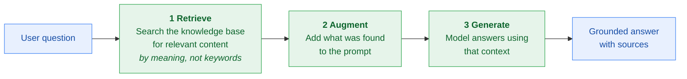
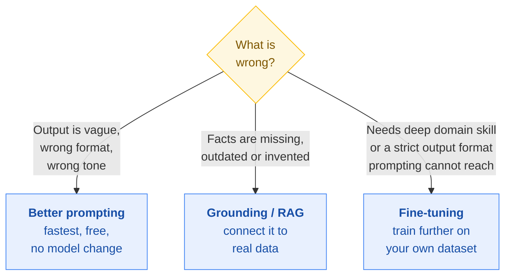

# Stage 4 · Gen AI Apps: Transform Your Work

[← Stage 3](stage-3-navigate-the-landscape.md) · [README](../README.md) · [Progress](../PROGRESS.md) · [Next: Stage 5 →](stage-5-agents-transform-your-organization.md)

**Course:** Gen AI Apps: Transform Your Work (fourth course in the learning path)
**Course link:** https://www.skills.google/paths/1951/course_templates/1266
**Effort:** around 3 hours
**Maps to exam sections:** 3.1, 3.2, 3.3 (the whole of "techniques to improve output"), plus 2.2

---

## What this stage gives you

The practical half of the exam. Section 3 is 20% on its own, and prompting plus grounding is almost all of it. This is also the most useful stage for your actual work, so it is worth doing properly rather than skimming.

Three lessons: prompting techniques, gen AI for productivity, and Gemini for Google Cloud.

---

## Topic checklist

### Lesson 1 · Prompting techniques
- [ ] What prompt engineering is and why it changes output quality so much
- [ ] **Zero-shot** prompting
- [ ] **One-shot** prompting
- [ ] **Few-shot** prompting
- [ ] **Role** prompting
- [ ] **Prompt chaining**
- [ ] **Chain of thought** prompting
- [ ] **ReAct** prompting
- [ ] **Metaprompting**
- [ ] Reusable prompts and Gems
- [ ] Sampling setting: **temperature**
- [ ] Sampling setting: **top-p**
- [ ] Sampling setting: **token count and output length**
- [ ] Sampling setting: **safety settings**
- [ ] What a **token** is and what a **context window** is

### Lesson 2 · Grounding and output quality
- [ ] What grounding is and the problem it solves
- [ ] Grounding sources: first-party, third-party, world data
- [ ] How retrieval augmented generation works, step by step
- [ ] Google's grounding offerings: Agent Search, RAG APIs, grounding with Google Search
- [ ] Grounding versus fine-tuning versus better prompting: how to choose
- [ ] Human in the loop as a quality control
- [ ] Model management after launch: versioning, performance tracking, drift monitoring

### Lesson 3 · Productivity tools
- [ ] Gemini app and Gemini Advanced
- [ ] Gemini for Google Workspace
- [ ] Gemini Enterprise
- [ ] NotebookLM and Gemini Notebook
- [ ] Gemini for Google Cloud, and what it helps with
- [ ] Which tool fits which kind of user

---

## Notes that matter for the exam

### Prompting techniques

| Technique | What you give the model | Use it when |
|---|---|---|
| **Zero-shot** | Just the instruction, no examples | The task is simple and common |
| **One-shot** | The instruction plus one example | You want a specific format and one sample shows it |
| **Few-shot** | The instruction plus several examples | The pattern is subtle, or you need consistency across many outputs |
| **Role** | "You are a financial analyst reviewing..." | You want a particular tone, expertise or point of view |
| **Prompt chaining** | Several prompts in sequence, each using the last answer | The task has steps that depend on each other |
| **Chain of thought** | "Think through this step by step" | Reasoning, maths, multi-step logic |
| **ReAct** | The model alternates reasoning and tool use | The model needs external information or needs to act |
| **Metaprompting** | Asking the model to write or improve a prompt | You are not sure how to phrase the prompt yourself |

> One-shot versus few-shot is a reliable exam question. **One** example is one-shot. **More than one** is few-shot.

**Gems** are reusable, saved prompts with instructions built in, so you do not rewrite the same setup every time.

### Sampling settings

These control how the model picks its next word.

| Setting | What it does | Turn it up for | Turn it down for |
|---|---|---|---|
| **Temperature** | How random the choice is | Creative writing, brainstorming | Factual answers, consistency, code |
| **Top-p** | Limits choices to the most likely words that add up to probability p | More variety | Tighter, more predictable output |
| **Output length / token count** | Caps how long the answer can be | Longer answers | Shorter answers, lower cost |
| **Safety settings** | Filters harmful content | n/a | Stricter filtering |

**Token:** a piece of text, roughly a word or part of a word. Pricing and limits are usually counted in tokens.
**Context window:** how much the model can consider at one time, including your prompt and its answer. Bigger window, more context, higher cost.

### Grounding

Grounding connects the model to specific, reliable data so its answers come from something real instead of only from its training.

**Three sources:**

| Source | What it is | Example |
|---|---|---|
| **First-party data** | Your own organisation's data | Internal policies, product catalogue, support tickets |
| **Third-party data** | Licensed data from another organisation | A market research dataset, a partner's feed |
| **World data** | Publicly available information | Grounding with Google Search |

### How RAG works

RAG is a **grounding method**. It fixes two limitations at once: knowledge cut-off (because the knowledge base can be current) and hallucination (because the answer is built from retrieved facts).

**Google's grounding offerings:** Agent Search (previously Vertex AI Search) for searching your own content, RAG APIs for building retrieval into your own application, and grounding with Google Search for public world data.

### Choosing between the three fixes

Order of effort: prompting, then grounding, then fine-tuning. Exam answers usually favour the lightest option that solves the described problem.

### Productivity tools, matched to the user

| Tool | Who it is for | What it does |
|---|---|---|
| **Gemini app** | Anyone | General purpose assistant, chat, generation |
| **Gemini Advanced** | Individuals needing more | Access to the most capable models and higher limits |
| **Gemini for Google Workspace** | Everyday knowledge workers | AI inside Docs, Gmail, Sheets, Slides and Meet |
| **Gemini Enterprise** | Organisations | Enterprise search and agents across company data, with enterprise controls |
| **NotebookLM / Gemini Notebook** | Anyone researching a set of sources | Grounded answers, summaries and audio overviews from documents you upload |
| **Gemini for Google Cloud** | Developers and cloud teams | Help writing code, explaining and operating cloud resources |

> The pattern in exam questions: match the **user** to the tool. A non-technical team improving daily work means Workspace with Gemini. Developers building something means Agent Platform or Gemini for Google Cloud. A whole company wanting to search its own content means Gemini Enterprise or Agent Search.

### Keeping output good over time

| Practice | Why |
|---|---|
| Versioning | Know exactly which model version produced which output |
| Performance tracking | Catch quality dropping before users complain |
| Drift monitoring | Real-world data changes, and the model goes stale |
| Security patches and upgrades | Models and platforms keep getting updates |
| Key performance indicators | Decide up front what "working" means, then measure it |
| Feature Store | Keep features consistent between training and serving |

---

## Extra resources

| Resource | Why bother |
|---|---|
| [Google AI Studio](https://aistudio.google.com) | Free. Change temperature and top-p on a real prompt and watch the output change. Worth an hour. |
| [NotebookLM](https://notebooklm.google.com) | Free. Upload the exam guide and quiz yourself. Grounding in action. |
| [Prompting guide for Gemini](https://cloud.google.com/vertex-ai/generative-ai/docs/learn/prompt-best-practices) | Google's own prompting best practice |
| [What is retrieval augmented generation?](https://cloud.google.com/use-cases/retrieval-augmented-generation) | Named in the official study guide |
| [Prompt Design in Vertex AI (skill badge)](https://www.cloudskillsboost.google/course_templates/976) | Hands-on lab if you want to actually build something |

---

## Self test

<b>1.</b> You give the model three sample support replies and ask it to write a fourth in the same style. Which prompting technique?

**Few-shot.** More than one example. One example would be one-shot, no examples would be zero-shot.

<b>2.</b> A legal team wants output that is consistent and strictly factual, with no creative variation. Which sampling setting do you change, and in which direction?

Lower the **temperature**. Low temperature makes the model pick the most likely next words, which gives consistent, predictable output. You could also tighten top-p.

<b>3.</b> An insurance company's assistant must answer only from that company's own policy documents. Which approach?

**Grounding with retrieval augmented generation** using the company's documents as first-party data, through something like Agent Search. Prompting alone will not stop the model answering from general knowledge.

<b>4.</b> What are the three steps of RAG?

**Retrieve** relevant information from a knowledge base based on meaning, **augment** the prompt with what was found, then **generate** the answer using that context.

<b>5.</b> What is the difference between a token and a context window?

A token is a unit of text, roughly a word or part of a word, and it is what usage is usually counted in. A context window is how much the model can consider at once, measured in tokens, covering both the prompt and the response.

<b>6.</b> A manager wants AI help drafting emails and summarising documents inside the tools her team already uses. Which product?

**Gemini for Google Workspace.** The point is AI inside Gmail, Docs and the rest, rather than a separate application to learn.

<b>7.</b> You ask the model to write the prompt you should use for a complex task. What is this called?

**Metaprompting.** You are using the model to produce or improve a prompt rather than to do the task directly.

<b>8.</b> A model works well at launch but accuracy declines over six months as customer behaviour changes. What is this, and what catches it?

This is **drift**. **Drift monitoring** as part of ongoing model management catches it, and retraining on fresher data fixes it.

**Score out of 8 → [PROGRESS.md](../PROGRESS.md)**

---

[← Stage 3](stage-3-navigate-the-landscape.md) · [Next: Stage 5 · Agents: Transform Your Organization →](stage-5-agents-transform-your-organization.md)
