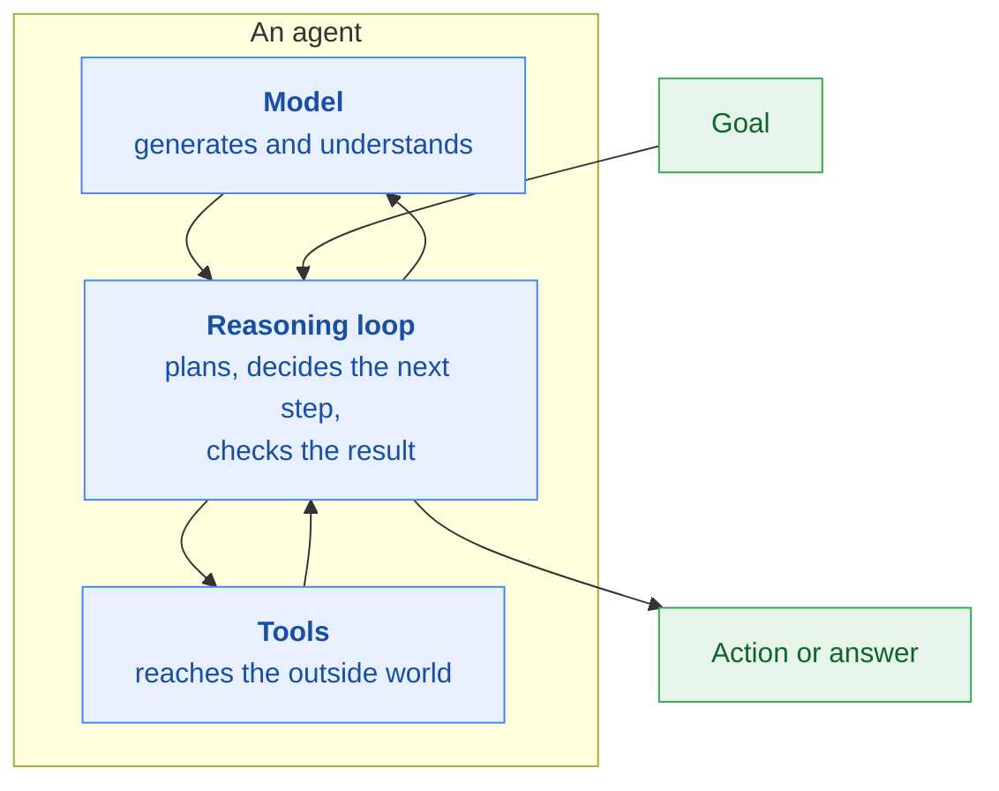
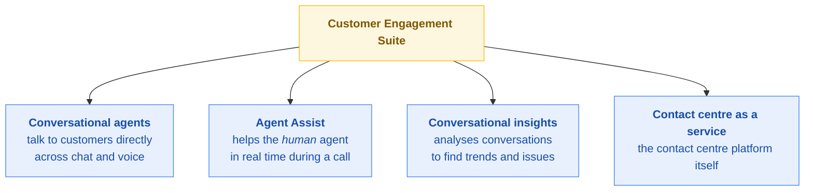
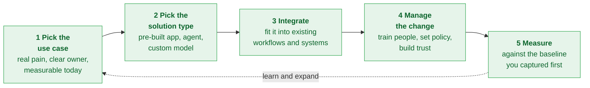

# Stage 5 · Gen AI Agents: Transform Your Organization

[← Stage 4](stage-4-apps-transform-your-work.md) · [README](../README.md) · [Progress](../PROGRESS.md) · [Next: Stage 6 →](stage-6-exam-readiness.md)

**Course:** Gen AI Agents: Transform Your Organization (fifth course in the learning path)
**Course link:** https://www.skills.google/paths/1951/course_templates/1267
**Effort:** around 3 hours
**Maps to exam sections:** 2.1, 2.3, 2.4, 2.5, 4.1

---

## What this stage gives you

The product knowledge that carries the heaviest exam section. Stage 3 told you what an agent is. This stage covers what agents are made of, how you build one, which Google product you pick for which situation, and how a business rolls this out and measures it.

Three lessons: today's agents, building agents, and improving customer experience with agents.

---

## Topic checklist

### Lesson 1 · Today's agents
- [ ] The three components of an agent: model, tools, reasoning loop
- [ ] Agent types: **deterministic**, **generative**, **hybrid**
- [ ] What agents can do that applications alone cannot
- [ ] Single agent versus multi-agent systems
- [ ] Where agents genuinely help a business, and where they do not

### Lesson 2 · Building agents
- [ ] Agent tooling: **extensions**
- [ ] Agent tooling: **functions**
- [ ] Agent tooling: **data stores**
- [ ] Agent tooling: **plugins**
- [ ] Agent Studio and when to use it
- [ ] Google AI Studio and when to use it
- [ ] Agent Platform: Model Garden, AutoML, custom training
- [ ] Pre-trained APIs an agent can call
- [ ] Ways to deploy a gen AI application: Cloud Run functions, Cloud Run, Apps Script, AppSheet
- [ ] No-code, low-code and full-code paths, and who each suits

### Lesson 3 · Customer experience
- [ ] Customer Engagement Suite: what is in it
- [ ] Conversational agents
- [ ] Agent Assist
- [ ] Conversational insights
- [ ] Contact centre as a service
- [ ] Agent Search for external and internal search
- [ ] Grounding with Google Search

### Google Cloud strengths and business strategy
- [ ] The seven reasons organisations choose Google Cloud for AI
- [ ] Choosing the right type of solution for a scenario
- [ ] Steps to integrate a gen AI solution into the business
- [ ] How to measure impact

---

## Notes that matter for the exam

### What an agent is made of

Take away any one of the three and it stops being an agent. No tools means it can only talk. No reasoning loop means it is a single-shot model call.

### Three agent types

| Type | How it decides | Good for | Trade-off |
|---|---|---|---|
| **Deterministic** | Follows defined rules and paths | Compliance-heavy or regulated flows where the path must be predictable | Rigid, breaks on anything unexpected |
| **Generative** | The model decides what to do next | Open-ended tasks, varied requests | Less predictable, harder to guarantee |
| **Hybrid** | Rules for the parts that must be fixed, model reasoning for the rest | Most real business cases | More to design and maintain |

> If a question mentions a regulated process, an auditable path or a guaranteed sequence, lean **deterministic** or **hybrid**. If it mentions handling unpredictable requests, lean **generative**.

### Agent tooling

This is a very likely exam question, so learn the four by what they connect to.

| Tool type | What it is |
|---|---|
| **Extensions** | A bridge to an external API, letting the agent call a live service |
| **Functions** | Code the developer defines, which the model can decide to call with arguments |
| **Data stores** | Structured and unstructured data the agent can look things up in, which is how grounding and RAG get wired in |
| **Plugins** | Packaged add-on capabilities an agent can use |

### Where to build

| Tool | Who it is for | What you build |
|---|---|---|
| **Agent Studio** | Business users and developers who want speed | Agents with a visual, low-code builder, hooked into enterprise data |
| **Google AI Studio** | Developers and anyone prototyping | Quick experiments with prompts and models, then export to code |
| **Agent Platform** | AI practitioners and developers | Full control: Model Garden, AutoML, custom training, MLOps |

**Rough rule:** AI Studio to try an idea, Agent Studio to ship an agent without heavy engineering, Agent Platform when you need control over the model itself.

### Pre-trained APIs an agent can call

Learn these by the input they take.

| API | Input → output |
|---|---|
| Speech-to-Text | Audio → text |
| Text-to-Speech | Text → audio |
| Translation | Text → text in another language |
| Document Translation | Document → translated document, formatting kept |
| Document AI | Documents → structured extracted data |
| Cloud Vision | Images → labels, text, objects |
| Cloud Video Intelligence | Video → labels, scenes, objects over time |
| Natural Language | Text → entities, sentiment, syntax |

### Ways to deploy a gen AI application

| Option | Best for |
|---|---|
| **Cloud Run functions** | A small piece of logic triggered by an event |
| **Cloud Run** | A full containerised application that scales automatically |
| **Apps Script** | Automating inside Google Workspace |
| **AppSheet** | No-code apps built by business users |

### Customer experience products

**The distinction that gets tested:** a conversational agent talks to the **customer**. Agent Assist helps the **human support agent** while they are talking to the customer. Read the question carefully for who is being helped.

**Search offerings:**

| Need | Product |
|---|---|
| Customers searching a company's public content | Agent Search (previously Vertex AI Search) |
| Employees searching internal company content | Gemini Enterprise, Agent Search |
| Answers that need current public information | Grounding with Google Search |

### Why organisations pick Google Cloud for AI

The exam guide lists these, and they show up as "which is a strength of Google Cloud" questions.

| Strength | What it means |
|---|---|
| **AI-first innovation** | Google builds its own models, chips and research rather than reselling |
| **Enterprise ready** | Responsible, secure, private, reliable and scalable by default |
| **The Google ecosystem** | Workspace, Search, Android and Cloud work together |
| **Open approach** | Open models such as Gemma, plus third-party models in Model Garden |
| **AI-optimised infrastructure** | TPUs, hypercomputers, global fibre network |
| **Data control** | Customers keep control of their own data |
| **Democratised development** | Low-code and no-code tools, pre-trained models and APIs, so not only ML engineers can build |

### Rolling out a solution

**Measuring impact:** compare against the baseline you recorded before launch. Good measures are business measures: time saved per case, cost per transaction, resolution rate, customer satisfaction, error rate, revenue influenced. Model accuracy alone is not impact.

---

## Extra resources

| Resource | Why bother |
|---|---|
| [What is AI Applications?](https://cloud.google.com/generative-ai-app-builder/docs/introduction) | Named in the official study guide |
| [Agent Search overview](https://cloud.google.com/enterprise-search) | The search product, in Google's words |
| [Customer Engagement Suite](https://cloud.google.com/solutions/customer-engagement-ai) | Covers the whole customer experience section |
| [Google AI Studio](https://aistudio.google.com) | Build a tiny agent with function calling and the tooling section stops being abstract |
| [Apps Script and Gemini](https://developers.google.com/apps-script) | Named in the official study guide as an entry point for building |

---

## Self test

<b>1.</b> What are the three components of an agent?

A **model**, a set of **tools**, and a **reasoning loop** that plans and decides what to do next.

<b>2.</b> A bank needs an agent for a regulated onboarding process where every step must follow an approved, auditable sequence. Which agent type?

**Deterministic**, or hybrid with deterministic control over the regulated steps. A fully generative agent cannot guarantee the same path every time, which is a problem when auditors ask.

<b>3.</b> An agent needs to check live stock levels from an existing inventory API. Which tooling type?

An **extension**, which bridges the agent to an external API. Data stores hold data for lookup, functions are developer-defined code the model can call.

<b>4.</b> A support centre wants to show its human staff suggested replies and relevant articles while they are on a call. Which product?

**Agent Assist.** It supports the human agent during the conversation. A conversational agent would be talking to the customer instead.

<b>5.</b> A business analyst with no coding experience wants to build an internal agent over company documents. Where do they build it?

**Agent Studio**, which gives a low-code way to build agents connected to enterprise data. Agent Platform would mean far more engineering than this person needs.

<b>6.</b> Which pre-trained API turns scanned invoices into structured fields?

**Document AI.** Cloud Vision reads images generally, Translation changes language, Natural Language analyses text meaning.

<b>7.</b> Name three reasons an enterprise would choose Google Cloud for gen AI.

Any three of: AI-first innovation with Google's own models and chips, an enterprise-ready platform that is secure, private, reliable and scalable, the wider Google ecosystem, an open approach including open and third-party models, AI-optimised infrastructure, customer control over their data, and development made accessible through low-code and no-code tooling.

<b>8.</b> A company launches a support agent and reports success because the model scores well on accuracy benchmarks. What is missing?

Business impact measured against the pre-launch baseline: handling time, resolution rate, customer satisfaction, cost per case. A model can score well and still change nothing about how the business performs.

**Score out of 8 → [PROGRESS.md](../PROGRESS.md)**

---

[← Stage 4](stage-4-apps-transform-your-work.md) · [Next: Stage 6 · Exam readiness →](stage-6-exam-readiness.md)
