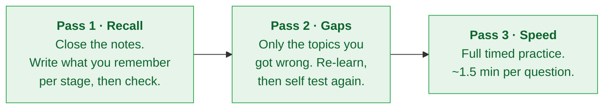

# Stage 6 · Exam readiness

[← Stage 5](stage-5-agents-transform-your-organization.md) · [README](../README.md) · [Progress](../PROGRESS.md)

**Effort:** around 5 hours
**Goal:** turn knowledge into a pass. No new material from here, only recall, practice and admin.

---

## Checklist

- [ ] Re-read the official exam guide, now that the words mean something
- [ ] Re-take the official sample questions and compare to your Stage 0 baseline
- [ ] Review every self test from Stages 1 to 5 in one sitting
- [ ] Clear the weak areas list in [PROGRESS.md](../PROGRESS.md)
- [ ] Two practice attempts in a row at 85% or above
- [ ] Confirm voucher eligibility and submit the voucher request form
- [ ] Voucher received
- [ ] Exam booked, delivery method chosen
- [ ] Test environment checked (if sitting online)
- [ ] ID ready and name matches your certification profile exactly

---

## Revision in three passes

Do not re-watch the courses. Watching feels productive and teaches almost nothing at this point. Recall does the work.

---

## The ten things people get wrong

Check you can answer all ten without looking.

1. Which layer of the landscape a scenario belongs to
2. Agent versus model (reasoning loop and tools is the difference)
3. Conversational agent versus workflow agent
4. Supervised versus unsupervised versus reinforcement learning
5. Grounding versus fine-tuning versus better prompting
6. One-shot versus few-shot
7. Temperature versus top-p
8. Which MLOps tool solves which problem
9. Agent Assist (helps the human) versus conversational agent (talks to the customer)
10. Edge versus cloud deployment

---

## How to attack the paper

**The rules you are working with**

- 50 to 60 multiple choice questions in 90 minutes, so roughly 1.5 minutes each
- No negative marking, so answer every single question
- Best-answer format, so more than one option may be technically correct
- No labs, no case studies, no practical exercises
- Google does not publish the pass mark

**Method**

1. **First pass, easy wins.** Answer everything you know immediately. Flag anything that needs thought and move on. Do not burn four minutes on question six.
2. **Second pass, flagged questions.** Use elimination. Remove the obviously wrong options first, then compare what is left against the constraint in the scenario.
3. **Third pass, check.** Make sure nothing is blank. A guess costs nothing.

**Reading a scenario**

The constraint is the answer. Look for the phrase that limits the options:

| Phrase in the question | What it is pushing you toward |
|---|---|
| "no coding experience" | Pre-built app, no-code tool, AutoML |
| "short on time" | Pre-trained API or existing application, not a custom build |
| "needs real-time response" | Edge deployment, lower latency |
| "sensitive or regulated data" | Security, privacy, on-device, deterministic path |
| "answers from our own documents" | Grounding and RAG |
| "must follow the same steps every time" | Deterministic or hybrid agent |
| "handles millions of requests" | Cloud, scalability |
| "needs to understand why it decided" | Explainability |

**Eliminating wrong options**

- Absolute words (always, never, completely eliminates, guarantees) are usually wrong
- Options from the wrong layer of the stack are usually wrong
- The most complex option (build a custom model from scratch) is usually wrong unless the question says full control is needed
- An option that solves a real problem, but not the one described, is the hardest distractor. Reread the question stem before choosing.

---

## Booking and sitting

**Voucher eligibility (program participants)**

Attend both ILT sessions in the first stage of the program, **or** complete all five courses and attend at least one ILT session. Then submit the voucher request form. Allow 24 to 72 working hours for it to arrive. Register with your voucher at the Google Cloud certification portal.

**Choosing a delivery method**

| | Online proctored | Test centre |
|---|---|---|
| Where | Home or office | Pearson VUE centre |
| Needs | Quiet private room, clear desk, webcam, stable connection, system check passed | Travel to the centre |
| Risk | A connection drop or someone walking in can end the attempt | Travel time, fixed slots |

**Before the day**

- Run the system check well in advance if sitting online
- Name on your ID must match your certification profile exactly
- Clear the desk and the walls behind you
- No second monitor, no phone, no notes, nothing you cannot explain to a proctor

**If you do not pass**

You can retake after 14 days the first time, 60 days the second time, and 1 year the third time. Each attempt needs a new voucher or payment. You get a score report showing each section as Meets, Borderline or Does Not Meet, which tells you exactly where to study. It is useful, not a verdict.

---

## After you pass

- [ ] Claim the digital badge
- [ ] Add the certification to LinkedIn (Licenses and Certifications, with the credential ID)
- [ ] Save the certificate PDF somewhere you will find it again
- [ ] Note the renewal window: the certification is valid for 3 years
- [ ] If the program offers a reward for passing, claim it

---

## Links

| What | Link |
|---|---|
| Exam registration | https://cp.certmetrics.com/google/en/login |
| Official sample questions | https://forms.gle/soztS7Q74AXBncATA |
| Official exam guide | https://services.google.com/fh/files/misc/generative_ai_leader_exam_guide_english.pdf |
| Certification FAQs | https://support.google.com/cloud-certification |

---

[← Stage 5](stage-5-agents-transform-your-organization.md) · [Back to README](../README.md) · [Progress dashboard](../PROGRESS.md)
